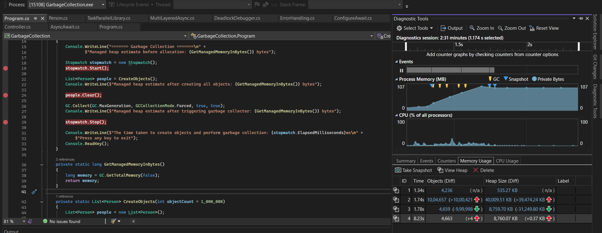

# Assignment 11

## Using Garbage Collection and Understanding Its Impact on Performance

### Garbage collector

The garbage collector can be triggered

- Manually by `GC.Collect()`.
- Automatically when a fixed threshold is reached.

It collects all the unreachable objects from the heap.

- **Automatic GC:** When the large number of objects are created and the number of unreachable objects increase above the threshold then the GC is called automatically.

- **GC.Collect():** When the GC is called the program execution is interrupted. So it can cause performance inpact in the application.

#### Roles of Garbage collector

- Manages memory
- It removes unused objects.
- Performs memory defragmentation.

#### Mark and Sweep

- The objects that can be removed are determined by the Mark and Sweep algorithm.
- If the object is reachable from the root then it is included in the graph of reachable object, all the other objects that are not present in the graph then it is removed by the Garbage collector.

#### Impact on Performance

- The Garbage collector requires CPU resources and can temporarily suspend the applicatoin threads while the runtime identifies and reclaims unreachable objects.
- Garbage collection is automatic and necessay, but object creation and unnecessary manual collections can reduce the performance of the application.

### Memory Management

- In this assignment we are using the GC.GetTotalMemory(false) this only returns the managed heap memory usage. So it reflects the effects of the `GC.Collect()` directly without using refresh.
- And this managed heap memory is different from the process memory(the total physical memory of the OS that is assigned to the application).

### Profiling Observation

- Creating 1,000,000 `Person` objects increased the object count by about 1,000,000, and the managed heap grew sharply, from about 500 KB to about 40000 KB.
- During allocation, the GC ran several times automatically (the GC markers in the graph). Because the objects were still referenced by the list, they were moved to higher generations instead of being removed.
- After removing the references (`people.Clear()`) and calling `GC.Collect(GC.MaxGeneration, GCCollectionMode.Forced, true, true)`, the object count dropped back to about 8000 KB.
- The Process Memory graph did not fall as sharply as the managed heap. This is because process memory includes the runtime, native allocations and memory the GC keeps reserved instead of returning it to the OS.
- The explicit collection was a blocking, so it paused the application and should be avoided in production code.

