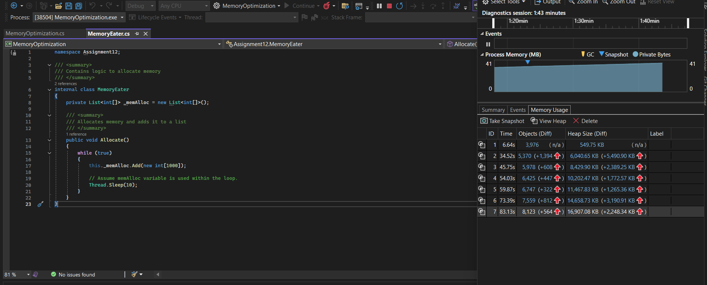
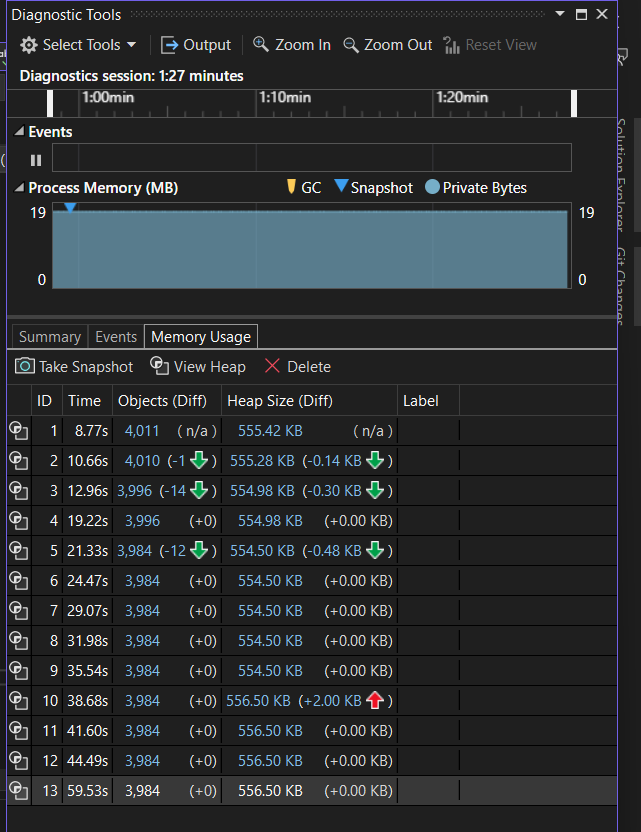

# Assignment 12 - Memory Optimization

## Task 1: Memory Leak / Optimization Identification

This section focuses on identifying and analyzing a subtle memory retention behavior in C# when managing dynamic collections, specifically looking at how `List<T>` elements are cleared versus how its internal buffers behave on the managed heap.

### Understanding about Memory Eater Code

- MemoryEater.cs creates a List of integer array.
- When the Allocate() method of MemoryEater.cs is called it increases the memory size for every 10 millisecond.
- As the all the objects have reference, the Garbage Collector doesn't collect any object that is created.
- So the memory usage significantly rises(observed from the diagnostic report) until OutOfMemoryException gets thrown and application gets crashed.

#### Memory Usage Before Optimization



### Memory Optimization techniques

- `MemoryOptimization.cs` doesn't need a List of integer array.
- Instead of creating a new array each time and gets added to the `_memAlloc` array we can uase the same array and modify the array and use it when required.
- We don't need the List<int[]> to maintain the previous array because we are not using those old arrays again.
- If we are using a different array each time we can we concepts like array pooling to use memory effeciently.

### Size of the array

- Array with more than 21249 elements will become a large object.
- Using large objects should be avoided, as the memory in large object heap will not be collected.

#### Memory Usage After Optimization



## ArrayPool

- They are commonly used in performance-sensitive applications when temporary buffers are created frequently
- It provides a way to reuse arrays instead of creating new ones repeatedly, reducing GC pressure.

### Key Concepts

- **Pooling:** Instead of allocating a new array every time, ArrayPool maintains a pool of arrays and reuses them.
- **Renting:** Rent an array of a certain minimum length from the pool.
- **Returning:** After use, we should return the array to the pool.

## Example

```c#
        // Get the shared instance of ArrayPool for int arrays
        ArrayPool<int> pool = ArrayPool<int>.Shared;

        // Rent an array of at least size 10
        int[] rentedArray = pool.Rent(10);

        for (int i = 0; i < 10; i++)
        {
            rentedArray[i] = i * i;
        }

        pool.Return(rentedArray);

```
