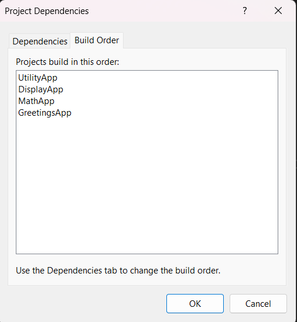
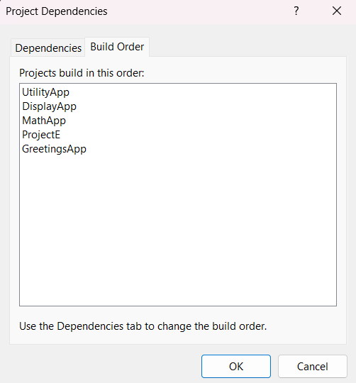
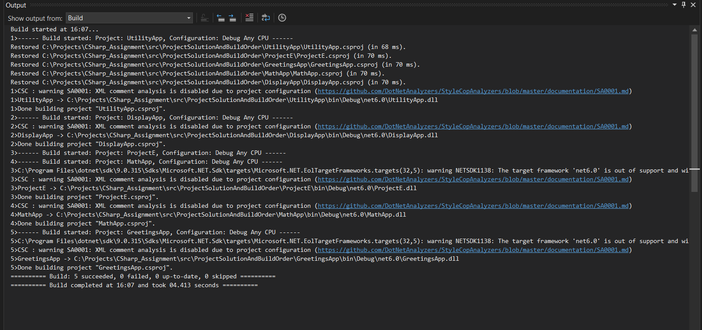
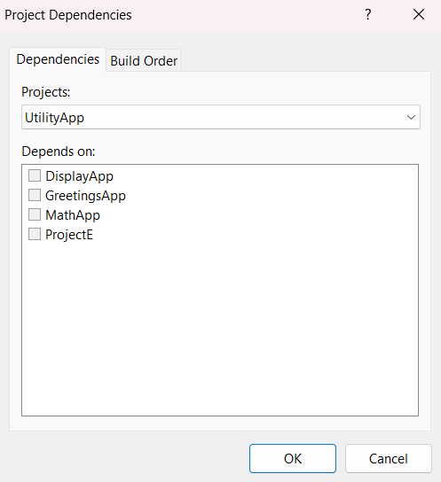
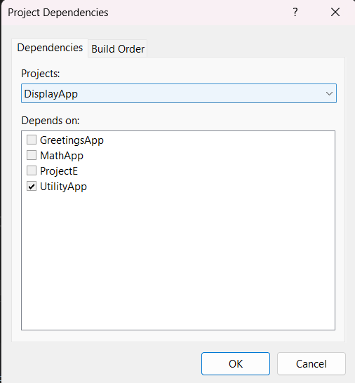
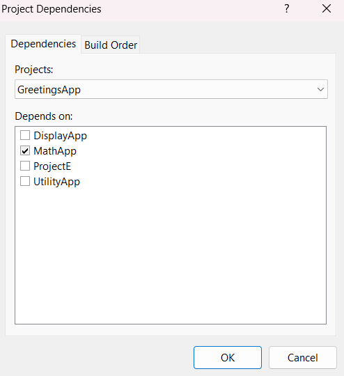
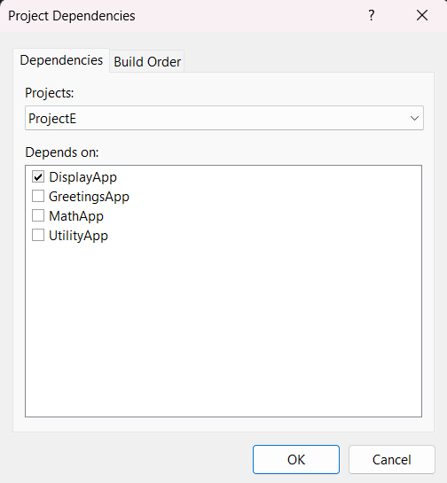

# Assignment 14 - Project, Solutions and Build Order

## Solution and projects

- Project is a unit of code that compiles into one output file. It is described by a `.csproj` file.

- Solution (`.sln` file) is used to groups related projects together. It lets Visual Studio open, build and configure them together. It does not contain code itself, it only lists which projects belong to it and how they are configured (Debug/Release).

My solution, `ProjectSolutionAndBuildOrder.sln`, has five projects:

 UtilityApp -> Class library
 DisplayApp -> Class library
 MathApp -> Class library
 GreetingsApp -> Console app
 ProjectE -> Console app

## Project references and dependencies

A project reference lets one project use the public classes of another. It is stored in the `.csproj`:

```xml
<ItemGroup>
  <ProjectReference Include="..\MathApp\MathApp.csproj" />
</ItemGroup>
```

If project A references project B, then A *depends on* B. B must be built before A, because A needs B's compiled `.dll`.

- `GreetingsApp.csproj` only depends on `MathApp`, but `GreetingsApp/Program.cs` uses `Display` from DisplayApp. This works because references are *transitive* GreetingsApp gets MathApp, and through MathApp it also gets DisplayApp and UtilityApp.
- Two projects cannot depend on each other (A -> B -> A).

## Build order

- The order in which Visual Studio compiles the projects. A project is built only after everything it depends on.
- Visual Studio calculates it from the dependencies.It can changed by changing dependencies.

### Build order of my solution before Project E



### Build order of my solution after Project E



### Solution Build output



### Dependency of the projects






